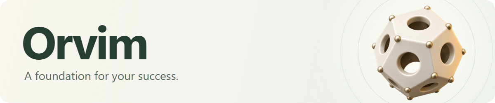

English | [Русский](README.ru.md)

<p align="center">
  <picture>
    <source media="(max-width: 600px)" srcset="docs/assets/readme/hero-mobile.png" />
    
  </picture>
</p>

<p align="center">
  Orvim is a personal planner and journal for Windows and Android.<br />
  See your schedule and tasks together, organize projects, capture ideas, and keep records of daily life.<br />
  Core features work offline and without an Orvim account.
</p>

<p align="center">
  <a href="docs/INSTALLATION.en.md#windows"></a>
  <a href="docs/INSTALLATION.en.md#android"></a>
  <a href="docs/PRIVACY.en.md#what-stays-on-your-device"></a>
  <a href="LICENSE"></a>
</p>

<p align="center">
  <strong>Orvim 0.4.48</strong><br />
  <a href="https://github.com/Adeptus-Amohus/orvim/releases/download/v0.4.48/Orvim-0.4.48-Windows-x64-setup.exe"><strong>Download for Windows (EXE)</strong></a> &nbsp; · &nbsp;
  <a href="https://github.com/Adeptus-Amohus/orvim/releases/download/v0.4.48/Orvim-0.4.48-Android-arm64.apk"><strong>Download for Android (APK)</strong></a><br />
  <a href="https://github.com/Adeptus-Amohus/orvim/releases/tag/v0.4.48">Release and checksums</a> &nbsp; / &nbsp;
  <a href="docs/INSTALLATION.en.md">Installation guide</a> &nbsp; / &nbsp;
  <a href="https://adeptus-amohus.github.io/orvim/">Website</a> &nbsp; / &nbsp;
  <a href="#interface">Interface</a> &nbsp; / &nbsp;
  <a href="#features">Features</a> &nbsp; / &nbsp;
  <a href="#feedback">Feedback</a>
</p>

## Interface

Home brings together your schedule, tasks, and a snapshot of your wellbeing.

<picture>
  <source media="(max-width: 600px)" srcset="docs/assets/readme/home-mobile-en.jpg" />
  
</picture>

<p align="center">
  <a href="docs/assets/readme/home-desktop-en.jpg">Open desktop screenshot</a> &nbsp; · &nbsp;
  <a href="docs/assets/readme/home-mobile-en.jpg">Open mobile screenshot</a>
</p>

<sub>Orvim 0.4.48 running in a browser preview with sample records.</sub>

<details>
<summary><strong>See the Projects screen</strong></summary>

### From an idea to the next task


</details>

## Features

| Where                     | What you can do                                                                                                                                                                                  |
| ------------------------- | ------------------------------------------------------------------------------------------------------------------------------------------------------------------------------------------------ |
| **Home**                  | Pick a date, see your schedule and tasks together, and mark tasks complete or reopen them.                                                                                                       |
| **Projects and Thoughts** | Keep project tasks and reference materials together, or jot down ideas separately. Search and edit your records.                                                                                 |
| **Life**                  | Log wellbeing, sleep, meals, water, weight, workouts, exercises, goals, steps, and finances. Review your statistics over time.                                                                   |
| **Database**              | Build your own collections with covers and ratings, and browse archived tasks.                                                                                                                   |
| **Data and appearance**   | Use a locally encrypted database, create portable backups protected by a password, and choose English or Russian, themes, and sounds.                                                            |
| **On your device**        | Add Android widgets for your schedule and tasks, thoughts, or nutrition. On Windows, choose whether closing the window keeps Orvim in the system tray.                                           |
| **Optional connections**  | Connect an AI provider, calendar, or Health Connect, or transfer records by file or over a local network. Choose the records you share with AI and review proposed changes before applying them. |

External services can require their own account, API key, permissions, or payment. Their terms apply to data you send them. [How Orvim handles your data](docs/PRIVACY.en.md).

## Installation and backups

You can download and install Orvim without a GitHub account or a development environment.

| Download                                                                                                            | Requirements                                                                               |
| ------------------------------------------------------------------------------------------------------------------- | ------------------------------------------------------------------------------------------ |
| [Windows EXE](https://github.com/Adeptus-Amohus/orvim/releases/download/v0.4.48/Orvim-0.4.48-Windows-x64-setup.exe) | Windows 10 or 11 (x64). If WebView2 is missing, the installer downloads it from Microsoft. |
| [Android APK](https://github.com/Adeptus-Amohus/orvim/releases/download/v0.4.48/Orvim-0.4.48-Android-arm64.apk)     | Android 7.0 (API 24) or later, an ARM64 device, and an up-to-date Android WebView.         |

Open the downloaded file and follow the installation prompts. Windows may show an unknown publisher warning because the EXE is unsigned. After installation, open **Home** to add your first task. [Installation and first launch](docs/INSTALLATION.en.md).

**Updating?** Before installing a new version, create an encrypted backup outside the app folder and test that you can restore it. If **Check GitHub** returns a 404 in 0.4.46 or 0.4.47, install 0.4.48 manually over the current release. In 0.4.48, the app checks the public repository and offers in-app installation for compatible packages from a verified, signed manifest. [Release notes](docs/releases/0.4.48.en.md) · [Backups and recovery](docs/BACKUPS.en.md).

**Coming from a test APK up to 0.4.45?** Android requires a reinstall because the release APK uses a different signing certificate. Before uninstalling, save a portable password-protected backup and confirm that it restores successfully on another device or installation. Automatic device-key backups and CSV exports cannot replace it. [Upgrade from an older test APK](docs/INSTALLATION.en.md#migrating-from-an-older-test-apk) · [Android signing details (Russian)](docs/ANDROID_SIGNING.md).

The APK and EXE were built from [source commit 98a7cd3](https://github.com/Adeptus-Amohus/orvim/tree/98a7cd344a2af75a5c63d574e8e6cd9516fc1c81). The [release](https://github.com/Adeptus-Amohus/orvim/releases/tag/v0.4.48) includes build provenance and SHA-256 checksums.

## Development

Orvim uses **Tauri 2**, **React 19**, **JavaScript/TypeScript**, **Vite**, and **Rust**. The installed app uses SQLite/SQLCipher. Android also uses Kotlin and Gradle. Dependency versions are pinned in `package-lock.json` and `src-tauri/Cargo.lock`.

On Windows, install Node.js **22.12+** (CI uses 24), npm, stable Rust with the MSVC toolchain, C++ Build Tools with the Windows SDK, and WebView2. Run these commands from the repository root:

```powershell
npm ci
npm run desktop:dev
```

To preview the app in a browser:

```powershell
npm run dev
```

Vite uses port 1420. The browser preview keeps separate data in IndexedDB and does not exercise the native features of the EXE or APK.

### Android

Android development requires **JDK 21**, SDK Platform 36, Build Tools 35.0.0 and 36.0.0, the NDK, and the `JAVA_HOME`, `ANDROID_HOME`, and `NDK_HOME` environment variables.

```powershell
npm run android:check
npm run android:dev -- --host 127.0.0.1
```

The [Android developer guide (Russian)](docs/ANDROID.md) covers setup, the emulator, USB, and APK builds. The instructions use your developer environment and do not require `.artifacts`.

## Checks and builds

<details>
<summary><strong>Windows and Android verification and build commands</strong></summary>

```powershell
npm run format:check
npm run build
npm run test:ui
npm run rust:fmt
npm run rust:check
npm run rust:lint
npm run rust:test
npm run licenses:check
node scripts/verify-site.mjs
node scripts/verify-doc-links.mjs
```

```powershell
npm run desktop:build
npm run tauri -- build --bundles nsis
npm run android:build -- --apk --target aarch64 --ci
```

`desktop:build` produces a standalone EXE. Release APKs use Orvim’s persistent Android signing key. See the [published verification report](https://github.com/Adeptus-Amohus/orvim/releases/download/v0.4.48/Verification.md), [GitHub CI](https://github.com/Adeptus-Amohus/orvim/actions/runs/43649365001), [development guide (Russian)](docs/DEVELOPMENT.md), and [release process (Russian)](docs/RELEASING.md).

DOM tests use simulated services. Release testing did not cover a physical ARM64 phone, every Android launcher, a clean Windows machine without WebView2, or live accounts for optional integrations. See the [0.4.48 release notes](docs/releases/0.4.48.en.md) and the verification report for the scope of the native checks.

</details>

## Repository layout

<details>
<summary><strong>Source, documentation, and distribution files</strong></summary>

```text
src/app/                     React/Tauri app shell
src/features/workspace/      Main interface, logic, and adapters
src/assets/                  Fonts and icon source assets
src-tauri/src/               IPC, SQLite, backups, transfers, and integrations
src-tauri/migrations/        SQLite migrations
src-tauri/gen/android/       Gradle, Kotlin, resources, and wrapper
tests/                       DOM, data, and browser tests
scripts/                     Tooling, licenses, and asset preparation
docs/                        Guides, architecture, and project history
site/                        GitHub Pages website
distribution/                Build provenance and verification
third-party/                 Third-party licenses and notices
```

The repository retains earlier MVP modules. The current UI starts in `src/app/FullApp.tsx`. The app ID `local.lifeos.client` and some older internal names remain for compatibility with existing installations and backups. See [Architecture (Russian)](docs/ARCHITECTURE.md) and [Repository contents (Russian)](docs/REPOSITORY.md#языки-и-состав-файлов).

</details>

## Documentation and contributing

| Using Orvim                                                                               | Working on Orvim                                 |
| ----------------------------------------------------------------------------------------- | ------------------------------------------------ |
| [Installation and first launch](docs/INSTALLATION.en.md)                                  | [Architecture (Russian)](docs/ARCHITECTURE.md)   |
| [Data and privacy](docs/PRIVACY.en.md)                                                    | [Android development (Russian)](docs/ANDROID.md) |
| [Backups and recovery](docs/BACKUPS.en.md)                                                | [Contributing](CONTRIBUTING.en.md)               |
| [Sync (Russian)](docs/SYNC_0_4.md) and [Health Connect (Russian)](docs/HEALTH_CONNECT.md) | [Security policy](SECURITY.en.md)                |
| [Updates and release notes](docs/releases/0.4.48.en.md)                                   | [Changelog (Russian)](CHANGELOG.md)              |

[Browse the documentation](docs/README.en.md).

### Feedback

[Email the maintainer](mailto:a.baimurzinov1@gmail.com) to ask a question or share feedback. You can also [report a bug on GitHub](https://github.com/Adeptus-Amohus/orvim/issues/new?template=bug.yml) with a GitHub account. Include your Orvim version, Windows or Android version, and the steps to reproduce it. Leave personal records, backups, and keys out of public reports. [How to send feedback](CONTRIBUTING.en.md#feedback-and-bug-reports).

## License

Orvim’s own code, documentation, and original assets are under **Apache-2.0**, except where separate terms are noted. See [LICENSE](LICENSE), [NOTICE](NOTICE), and [license details (Russian)](docs/LICENSES.md). Fonts retain their SIL OFL 1.1 terms. Dependencies and user content keep their own terms.

See [THIRD_PARTY_LICENSES.txt](THIRD_PARTY_LICENSES.txt) for third-party license texts. Run `npm run licenses:generate` and `npm run licenses:check` to generate and verify the inventory. [Third-party license coverage (Russian)](third-party/README.md).
