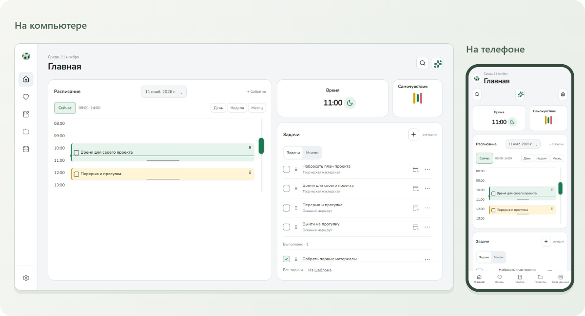
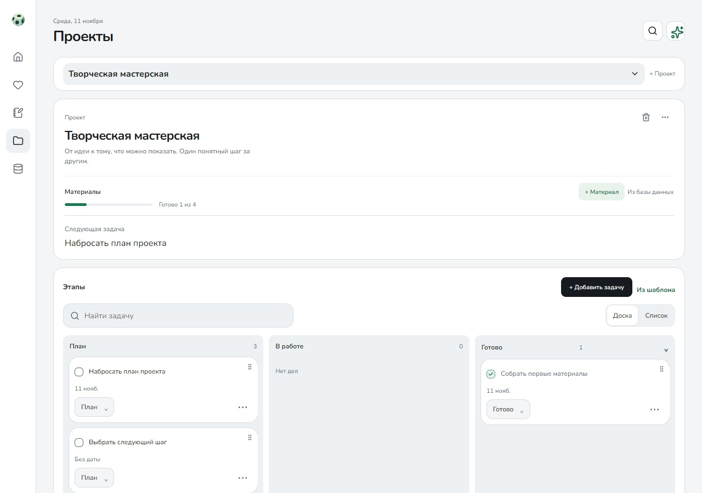
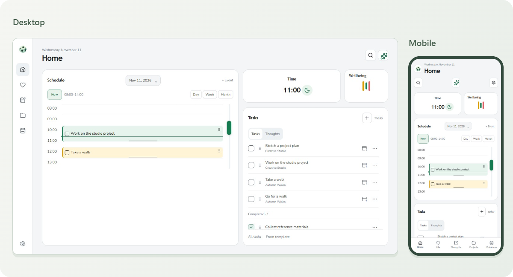
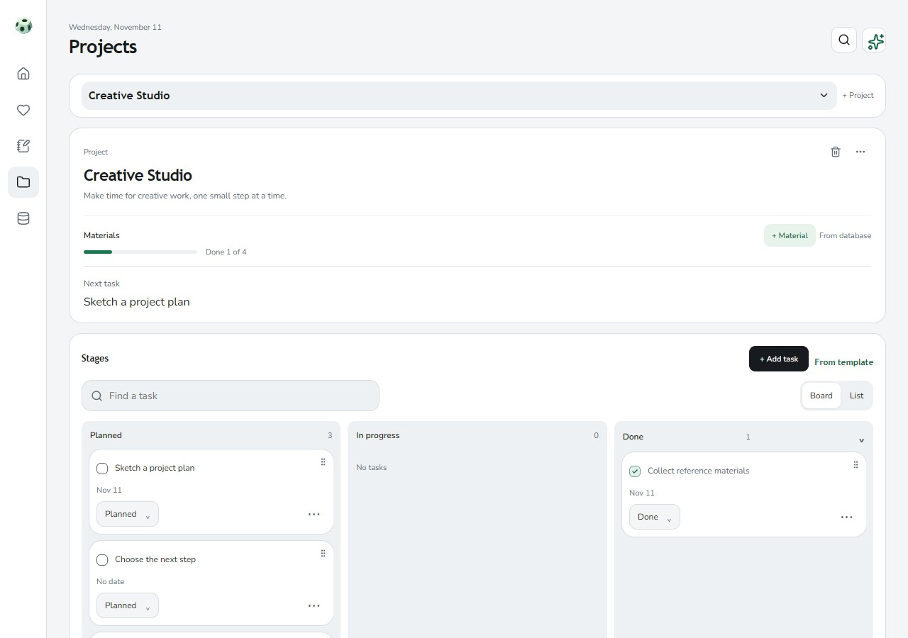

# Orvim

<details>
<summary><strong>Читать на русском</strong></summary>

<p align="center">
  <picture>
    <source media="(max-width: 600px)" srcset="docs/assets/readme/hero-mobile.png" />
    
  </picture>
</p>

<p align="center">
  Задачи, проекты, мысли и личные записи — в одном локальном пространстве.<br />
  Основные разделы работают без аккаунта и интернета.<br />
  <em>A foundation for your success.</em>
</p>

<p align="center">
  <a href="#разработка"></a>
  <a href="docs/ANDROID.md"></a>
  <a href="docs/ARCHITECTURE.md"></a>
  <a href="LICENSE"></a>
</p>

<p align="center">
  <strong>Orvim 0.4.48</strong><br />
  <a href="https://github.com/Adeptus-Amohus/orvim/releases/download/v0.4.48/Orvim-0.4.48-Windows-x64-setup.exe"><strong>Скачать Windows EXE</strong></a> &nbsp; · &nbsp;
  <a href="https://github.com/Adeptus-Amohus/orvim/releases/download/v0.4.48/Orvim-0.4.48-Android-arm64.apk"><strong>Скачать Android APK</strong></a><br />
  <a href="https://github.com/Adeptus-Amohus/orvim/releases/tag/v0.4.48">Релиз и SHA-256</a> &nbsp; / &nbsp;
  <a href="docs/INSTALLATION.md">Установка и первый запуск</a> &nbsp; / &nbsp;
  <a href="https://adeptus-amohus.github.io/orvim/">Сайт Orvim</a> &nbsp; / &nbsp;
  <a href="#интерфейс">Интерфейс</a> &nbsp; / &nbsp;
  <a href="#возможности">Возможности</a> &nbsp; / &nbsp;
  <a href="#разработка">Запуск</a> &nbsp; / &nbsp;
  <a href="docs/README.md">Документация</a>
</p>

## Интерфейс

Расписание, задачи и самочувствие — на компьютере и небольшом экране.

<picture>
  <source media="(max-width: 600px)" srcset="docs/assets/readme/home-mobile.jpg" />
  
</picture>

<p align="center">
  <a href="docs/assets/readme/home-desktop.jpg">Открыть снимок ПК</a> &nbsp; · &nbsp;
  <a href="docs/assets/readme/home-mobile.jpg">Открыть мобильный снимок</a>
</p>

<sub>Реальный интерфейс в браузерном стенде, вымышленные данные. Мобильная компоновка — 390 px, не снимок установленного APK.</sub>

<details>
<summary><strong>Ещё один экран: проекты</strong></summary>

### От замысла к следующему шагу



</details>

## Возможности

| Раздел                     | Что внутри                                                                                                                      |
| -------------------------- | ------------------------------------------------------------------------------------------------------------------------------- |
| **Главная**                | Расписание и задачи на выбранный день, выполнение и отмена выполнения.                                                          |
| **Проекты и мысли**        | Задачи проекта, материалы, самостоятельные заметки, поиск и редактирование.                                                     |
| **Жизнь**                  | Личный день, самочувствие, сон, питание, вода, вес, тренировки, упражнения, цели, шаги, финансы и статистика.                   |
| **База данных**            | Пользовательские коллекции, обложки, оценки и архив завершённых дел.                                                            |
| **Данные и оформление**    | Зашифрованная локальная база, переносимые копии с паролем, автоматические снимки, русский и английский интерфейс, темы и звуки. |
| **На устройстве**          | Android-виджеты расписания/задач, мысли и питания; системный трей и настройка закрытия окна Windows.                            |
| **Подключения по желанию** | ИИ с вручную выбранными данными и подтверждением изменений, календарь, Health Connect, файловый/LAN-обмен с проверкой импорта.  |

Аккаунт Orvim не требуется. Подключённые сервисы могут требовать свои аккаунты, ключи, разрешения и оплату. Данные, отправленные сервису, обрабатываются по его условиям. [Данные и приватность](docs/PRIVACY.md).

Изменения и проверки текущего выпуска описаны в [заметках Orvim 0.4.48](docs/releases/0.4.48.md).

## Установка и сохранность данных

В версии **0.4.48** исправлена проверка обновлений. Кнопка «Проверить на GitHub» обращается к публичному Orvim. Для совместимых выпусков кнопки загрузки и установки появляются после проверки подписанного манифеста. [Заметки выпуска](docs/releases/0.4.48.md) · [Установка и обновление](docs/INSTALLATION.md).

Скачивание и инструкции доступны без аккаунта GitHub. Среда разработки для установки не нужна. Файлы находятся в [GitHub Release v0.4.48](https://github.com/Adeptus-Amohus/orvim/releases/tag/v0.4.48):

| Файл                                                                                                                        | Назначение                                                                                                    |
| --------------------------------------------------------------------------------------------------------------------------- | ------------------------------------------------------------------------------------------------------------- |
| [Скачать Windows EXE](https://github.com/Adeptus-Amohus/orvim/releases/download/v0.4.48/Orvim-0.4.48-Windows-x64-setup.exe) | Установщик Windows 10/11 x64; нужен WebView2. При отсутствии runtime установщик скачивает его через интернет. |
| [Скачать Android APK](https://github.com/Adeptus-Amohus/orvim/releases/download/v0.4.48/Orvim-0.4.48-Android-arm64.apk)     | Android 7.0/API 24+, ARM64, актуальный Android WebView. Отдельных x86 и 32-битных ARM APK нет.                |

Исходники APK и EXE зафиксированы в [коммите 98a7cd3](https://github.com/Adeptus-Amohus/orvim/tree/98a7cd344a2af75a5c63d574e8e6cd9516fc1c81). Сведения о сборке и SHA-256 входят в выпуск.

Установленные 0.4.46 и 0.4.47 с ошибкой 404 обновите вручную поверх прежней версии. Начиная с 0.4.48 Orvim использует подписанный список пакетов для встроенной установки. Windows EXE не подписан Authenticode и может вызывать системное предупреждение.

Перед обновлением создайте и проверьте **копию с паролем** вне приватной папки приложения. **Обновление с тестовых APK до 0.4.45 требует переустановки.** До удаления тестовой установки проверьте восстановление копии на отдельном устройстве. [Безопасный переход](docs/INSTALLATION.md#переход-со-старого-тестового-apk). Следующие release APK должны сохранять новый постоянный сертификат. Windows обновляется обычным установщиком поверх прежней версии. [Копии и восстановление](docs/BACKUPS.md).

Порядок перехода с тестового APK: переносимая копия с паролем → проверка восстановления → переустановка → восстановление данных. Автоматический снимок с ключом устройства и CSV не заменяют полную переносимую копию. [Сохранение существующего ключа подписи](docs/ANDROID_SIGNING.md).

## Разработка

Orvim использует **Tauri 2**, **React 19**, **JavaScript/TypeScript**, **Vite** и **Rust**. Нативное хранилище — SQLite/SQLCipher; Android-часть использует также Kotlin и Gradle. Зависимости закреплены `package-lock.json` и `src-tauri/Cargo.lock`.

Для Windows нужны Node.js **22.12+** (в CI используется 24), npm, Rust stable с MSVC, C++ Build Tools с Windows SDK и WebView2. Команды выполняются из корня репозитория:

```powershell
npm ci
npm run desktop:dev
```

Просмотр в браузере:

```powershell
npm run dev
```

Vite использует порт 1420. Браузерный режим хранит отдельные данные в IndexedDB и не подтверждает работу нативных функций EXE/APK.

### Android

Android требует **JDK 21**, SDK Platform 36, Build Tools 35.0.0 и 36.0.0, NDK и переменные `JAVA_HOME`, `ANDROID_HOME`, `NDK_HOME`:

```powershell
npm run android:check
npm run android:dev -- --host 127.0.0.1
```

Полная настройка, эмулятор, USB и APK: [ANDROID.md](docs/ANDROID.md). Инструкции используют окружение разработчика; .artifacts не требуется.

## Проверки и сборки

<details>
<summary><strong>Команды проверки и сборки Windows / Android</strong></summary>

```powershell
npm run format:check
npm run build
npm run test:ui
npm run rust:fmt
npm run rust:check
npm run rust:lint
npm run rust:test
npm run licenses:check
node scripts/verify-site.mjs
node scripts/verify-doc-links.mjs
```

```powershell
npm run desktop:build
npm run tauri -- build --bundles nsis
npm run android:build -- --apk --target aarch64 --ci
```

`desktop:build` создаёт EXE без установщика. Android release APK подписывается постоянным ключом. Подробности проверки файлов доступны в [отчёте выпуска](https://github.com/Adeptus-Amohus/orvim/releases/download/v0.4.48/Verification.md) и [GitHub CI](https://github.com/Adeptus-Amohus/orvim/actions/runs/43649365001). [Разработка](docs/DEVELOPMENT.md), [порядок выпуска](docs/RELEASING.md).

DOM-тесты используют синтетические сервисы. Физический ARM64-телефон, все OEM-лаунчеры, чистая Windows без WebView2 и живые аккаунты внешних подключений этим выпуском не проверены. Нативные проверки ранее выпущенных файлов и их границы описаны в [заметках 0.4.48](docs/releases/0.4.48.md).

</details>

## Структура

<details>
<summary><strong>Как устроен репозиторий</strong></summary>

```text
src/app/                     React/Tauri оболочка
src/features/workspace/      основной интерфейс, логика, адаптеры
src/assets/                  шрифты и исходники значков
src-tauri/src/               IPC, SQLite, копии, обмен, подключения
src-tauri/migrations/        миграции SQLite
src-tauri/gen/android/       Gradle, Kotlin, ресурсы и wrapper
tests/                       DOM, данные, браузерные сценарии
scripts/                     среда, лицензии, подготовка ресурсов
docs/                        инструкции, архитектура и история
site/                        сайт GitHub Pages
distribution/                происхождение и проверки готовых файлов
third-party/                 сторонние лицензии и уведомления
```

Сохранены прежние модули MVP. Текущий интерфейс запускается через src/app/FullApp.tsx; текущая модель описана в [архитектуре](docs/ARCHITECTURE.md). Идентификатор local.lifeos.client и старые технические имена остаются для совместимости установок и копий.

Статистика языков зависит от фактического состава файлов: прежний публичный репозиторий содержал только HTML/CSS/JS сайта; теперь учитываются также JavaScript/TypeScript приложения, Rust, Kotlin, тесты и инструменты. Атрибуты Linguist ради процентов не меняются. [Состав файлов](docs/REPOSITORY.md#языки-и-состав-файлов).

</details>

## Документация и участие

| Для пользователя                          | Для разработчика                        |
| ----------------------------------------- | --------------------------------------- |
| [Данные и приватность](docs/PRIVACY.md)   | [Архитектура](docs/ARCHITECTURE.md)     |
| [Копии и восстановление](docs/BACKUPS.md) | [Настройка Android](docs/ANDROID.md)    |
| [Синхронизация](docs/SYNC_0_4.md)         | [Участие в проекте](CONTRIBUTING.ru.md) |
| [Health Connect](docs/HEALTH_CONNECT.md)  | [Безопасность](SECURITY.ru.md)          |
| [Обновления](docs/UPDATES.md)             | [История изменений](CHANGELOG.md)       |

[Открыть всю документацию →](docs/README.md)

### Обратная связь

[Напишите автору](mailto:a.baimurzinov1@gmail.com), если хотите задать вопрос или поделиться отзывом. Для [сообщения об ошибке на GitHub](https://github.com/Adeptus-Amohus/orvim/issues/new?template=bug.yml) понадобится аккаунт. Укажите версию Orvim, версию Windows или Android и шаги, на которых возникает ошибка. Личные записи, копии базы и ключи оставляйте за пределами публичного отчёта. [Как отправить отзыв](CONTRIBUTING.ru.md#отзывы-и-сообщения-об-ошибках).

## Лицензия

Собственный код, документация и оригинальные ресурсы проекта распространяются под **Apache-2.0**, кроме компонентов с отдельно указанными условиями. См. [LICENSE](LICENSE), [NOTICE](NOTICE) и [разбор лицензий](docs/LICENSES.md). Шрифты сохраняют SIL OFL 1.1; зависимости и пользовательские материалы не перелицензируются.

Полные сторонние тексты: [THIRD_PARTY_LICENSES.txt](THIRD_PARTY_LICENSES.txt). Подготовка и проверка: `npm run licenses:generate` и `npm run licenses:check`; область покрытия описана в [third-party/README.md](third-party/README.md).

</details>

<p align="center">
  <picture>
    <source media="(max-width: 600px)" srcset="docs/assets/readme/hero-mobile.png" />
    
  </picture>
</p>

<p align="center">
  Orvim is a personal planner and journal for Windows and Android.<br />
  See your schedule and tasks together, organize projects, capture ideas, and keep records of daily life.<br />
  Core features work offline and without an Orvim account.
</p>

<p align="center">
  <a href="docs/INSTALLATION.en.md#windows"></a>
  <a href="docs/INSTALLATION.en.md#android"></a>
  <a href="docs/PRIVACY.en.md#what-stays-on-your-device"></a>
  <a href="LICENSE"></a>
</p>

<p align="center">
  <strong>Orvim 0.4.48</strong><br />
  <a href="https://github.com/Adeptus-Amohus/orvim/releases/download/v0.4.48/Orvim-0.4.48-Windows-x64-setup.exe"><strong>Download for Windows (EXE)</strong></a> &nbsp; · &nbsp;
  <a href="https://github.com/Adeptus-Amohus/orvim/releases/download/v0.4.48/Orvim-0.4.48-Android-arm64.apk"><strong>Download for Android (APK)</strong></a><br />
  <a href="https://github.com/Adeptus-Amohus/orvim/releases/tag/v0.4.48">Release and checksums</a> &nbsp; / &nbsp;
  <a href="docs/INSTALLATION.en.md">Installation guide</a> &nbsp; / &nbsp;
  <a href="https://adeptus-amohus.github.io/orvim/">Website</a> &nbsp; / &nbsp;
  <a href="#interface">Interface</a> &nbsp; / &nbsp;
  <a href="#features">Features</a> &nbsp; / &nbsp;
  <a href="#feedback">Feedback</a>
</p>

## Interface

Home brings together your schedule, tasks, and a snapshot of your wellbeing.

<picture>
  <source media="(max-width: 600px)" srcset="docs/assets/readme/home-mobile-en.jpg" />
  
</picture>

<p align="center">
  <a href="docs/assets/readme/home-desktop-en.jpg">Open desktop screenshot</a> &nbsp; · &nbsp;
  <a href="docs/assets/readme/home-mobile-en.jpg">Open mobile screenshot</a>
</p>

<sub>Orvim 0.4.48 running in a browser preview with sample records.</sub>

<details>
<summary><strong>See the Projects screen</strong></summary>

### From an idea to the next task



</details>

## Features

| Where                     | What you can do                                                                                                                                                                                  |
| ------------------------- | ------------------------------------------------------------------------------------------------------------------------------------------------------------------------------------------------ |
| **Home**                  | Pick a date, see your schedule and tasks together, and mark tasks complete or reopen them.                                                                                                       |
| **Projects and Thoughts** | Keep project tasks and reference materials together, or jot down ideas separately. Search and edit your records.                                                                                 |
| **Life**                  | Log wellbeing, sleep, meals, water, weight, workouts, exercises, goals, steps, and finances. Review your statistics over time.                                                                   |
| **Database**              | Build your own collections with covers and ratings, and browse archived tasks.                                                                                                                   |
| **Data and appearance**   | Use a locally encrypted database, create portable backups protected by a password, and choose English or Russian, themes, and sounds.                                                            |
| **On your device**        | Add Android widgets for your schedule and tasks, thoughts, or nutrition. On Windows, choose whether closing the window keeps Orvim in the system tray.                                           |
| **Optional connections**  | Connect an AI provider, calendar, or Health Connect, or transfer records by file or over a local network. Choose the records you share with AI and review proposed changes before applying them. |

External services can require their own account, API key, permissions, or payment. Their terms apply to data you send them. [How Orvim handles your data](docs/PRIVACY.en.md).

## Installation and backups

You can download and install Orvim without a GitHub account or a development environment.

| Download                                                                                                            | Requirements                                                                               |
| ------------------------------------------------------------------------------------------------------------------- | ------------------------------------------------------------------------------------------ |
| [Windows EXE](https://github.com/Adeptus-Amohus/orvim/releases/download/v0.4.48/Orvim-0.4.48-Windows-x64-setup.exe) | Windows 10 or 11 (x64). If WebView2 is missing, the installer downloads it from Microsoft. |
| [Android APK](https://github.com/Adeptus-Amohus/orvim/releases/download/v0.4.48/Orvim-0.4.48-Android-arm64.apk)     | Android 7.0 (API 24) or later, an ARM64 device, and an up-to-date Android WebView.         |

Open the downloaded file and follow the installation prompts. Windows may show an unknown publisher warning because the EXE is unsigned. After installation, open **Home** to add your first task. [Installation and first launch](docs/INSTALLATION.en.md).

**Updating?** Before installing a new version, create an encrypted backup outside the app folder and test that you can restore it. If **Check GitHub** returns a 404 in 0.4.46 or 0.4.47, install 0.4.48 manually over the current release. In 0.4.48, the app checks the public repository and offers in-app installation for compatible packages from a verified, signed manifest. [Release notes](docs/releases/0.4.48.en.md) · [Backups and recovery](docs/BACKUPS.en.md).

**Coming from a test APK up to 0.4.45?** Android requires a reinstall because the release APK uses a different signing certificate. Before uninstalling, save a portable password-protected backup and confirm that it restores successfully on another device or installation. Automatic device-key backups and CSV exports cannot replace it. [Upgrade from an older test APK](docs/INSTALLATION.en.md#migrating-from-an-older-test-apk) · [Android signing details (Russian)](docs/ANDROID_SIGNING.md).

The APK and EXE were built from [source commit 98a7cd3](https://github.com/Adeptus-Amohus/orvim/tree/98a7cd344a2af75a5c63d574e8e6cd9516fc1c81). The [release](https://github.com/Adeptus-Amohus/orvim/releases/tag/v0.4.48) includes build provenance and SHA-256 checksums.

## Development

Orvim uses **Tauri 2**, **React 19**, **JavaScript/TypeScript**, **Vite**, and **Rust**. The installed app uses SQLite/SQLCipher. Android also uses Kotlin and Gradle. Dependency versions are pinned in `package-lock.json` and `src-tauri/Cargo.lock`.

On Windows, install Node.js **22.12+** (CI uses 24), npm, stable Rust with the MSVC toolchain, C++ Build Tools with the Windows SDK, and WebView2. Run these commands from the repository root:

```powershell
npm ci
npm run desktop:dev
```

To preview the app in a browser:

```powershell
npm run dev
```

Vite uses port 1420. The browser preview keeps separate data in IndexedDB and does not exercise the native features of the EXE or APK.

### Android

Android development requires **JDK 21**, SDK Platform 36, Build Tools 35.0.0 and 36.0.0, the NDK, and the `JAVA_HOME`, `ANDROID_HOME`, and `NDK_HOME` environment variables.

```powershell
npm run android:check
npm run android:dev -- --host 127.0.0.1
```

The [Android developer guide (Russian)](docs/ANDROID.md) covers setup, the emulator, USB, and APK builds. The instructions use your developer environment and do not require `.artifacts`.

## Checks and builds

<details>
<summary><strong>Windows and Android verification and build commands</strong></summary>

```powershell
npm run format:check
npm run build
npm run test:ui
npm run rust:fmt
npm run rust:check
npm run rust:lint
npm run rust:test
npm run licenses:check
node scripts/verify-site.mjs
node scripts/verify-doc-links.mjs
```

```powershell
npm run desktop:build
npm run tauri -- build --bundles nsis
npm run android:build -- --apk --target aarch64 --ci
```

`desktop:build` produces a standalone EXE. Release APKs use Orvim’s persistent Android signing key. See the [published verification report](https://github.com/Adeptus-Amohus/orvim/releases/download/v0.4.48/Verification.md), [GitHub CI](https://github.com/Adeptus-Amohus/orvim/actions/runs/43649365001), [development guide (Russian)](docs/DEVELOPMENT.md), and [release process (Russian)](docs/RELEASING.md).

DOM tests use simulated services. Release testing did not cover a physical ARM64 phone, every Android launcher, a clean Windows machine without WebView2, or live accounts for optional integrations. See the [0.4.48 release notes](docs/releases/0.4.48.en.md) and the verification report for the scope of the native checks.

</details>

## Repository layout

<details>
<summary><strong>Source, documentation, and distribution files</strong></summary>

```text
src/app/                     React/Tauri app shell
src/features/workspace/      Main interface, logic, and adapters
src/assets/                  Fonts and icon source assets
src-tauri/src/               IPC, SQLite, backups, transfers, and integrations
src-tauri/migrations/        SQLite migrations
src-tauri/gen/android/       Gradle, Kotlin, resources, and wrapper
tests/                       DOM, data, and browser tests
scripts/                     Tooling, licenses, and asset preparation
docs/                        Guides, architecture, and project history
site/                        GitHub Pages website
distribution/                Build provenance and verification
third-party/                 Third-party licenses and notices
```

The repository retains earlier MVP modules. The current UI starts in `src/app/FullApp.tsx`. The app ID `local.lifeos.client` and some older internal names remain for compatibility with existing installations and backups. See [Architecture (Russian)](docs/ARCHITECTURE.md) and [Repository contents (Russian)](docs/REPOSITORY.md#языки-и-состав-файлов).

</details>

## Documentation and contributing

| Using Orvim                                                                               | Working on Orvim                                 |
| ----------------------------------------------------------------------------------------- | ------------------------------------------------ |
| [Installation and first launch](docs/INSTALLATION.en.md)                                  | [Architecture (Russian)](docs/ARCHITECTURE.md)   |
| [Data and privacy](docs/PRIVACY.en.md)                                                    | [Android development (Russian)](docs/ANDROID.md) |
| [Backups and recovery](docs/BACKUPS.en.md)                                                | [Contributing](CONTRIBUTING.md)                  |
| [Sync (Russian)](docs/SYNC_0_4.md) and [Health Connect (Russian)](docs/HEALTH_CONNECT.md) | [Security policy](SECURITY.md)                   |
| [Updates and release notes](docs/releases/0.4.48.en.md)                                   | [Changelog (Russian)](CHANGELOG.md)              |

[Browse the documentation](docs/README.en.md).

### Feedback

[Email the maintainer](mailto:a.baimurzinov1@gmail.com) to ask a question or share feedback. You can also [report a bug on GitHub](https://github.com/Adeptus-Amohus/orvim/issues/new?template=bug.yml) with a GitHub account. Include your Orvim version, Windows or Android version, and the steps to reproduce it. Leave personal records, backups, and keys out of public reports. [How to send feedback](CONTRIBUTING.md#feedback-and-bug-reports).

## License

Orvim’s own code, documentation, and original assets are under **Apache-2.0**, except where separate terms are noted. See [LICENSE](LICENSE), [NOTICE](NOTICE), and [license details (Russian)](docs/LICENSES.md). Fonts retain their SIL OFL 1.1 terms. Dependencies and user content keep their own terms.

See [THIRD_PARTY_LICENSES.txt](THIRD_PARTY_LICENSES.txt) for third-party license texts. Run `npm run licenses:generate` and `npm run licenses:check` to generate and verify the inventory. [Third-party license coverage (Russian)](third-party/README.md).
