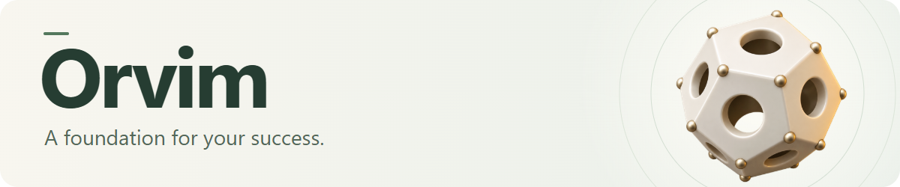
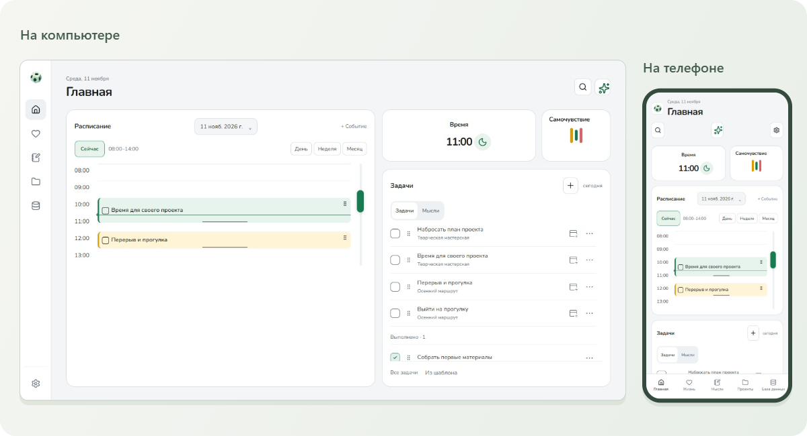
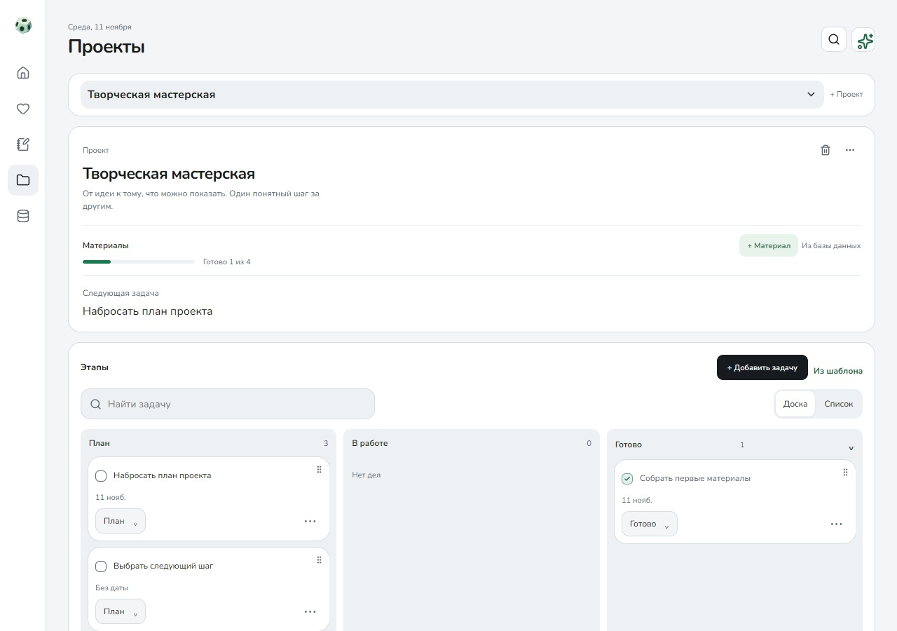

<p align="center">
  <picture>
    <source media="(max-width: 600px)" srcset="docs/assets/readme/hero-mobile.png" />
    
  </picture>
</p>

<p align="center">
  Задачи, проекты, мысли и личные записи — в одном локальном пространстве.<br />
  Основные разделы работают без аккаунта и интернета.<br />
  <em>A foundation for your success.</em>
</p>

<p align="center">
  <a href="#разработка"></a>
  <a href="docs/ANDROID.md"></a>
  <a href="docs/ARCHITECTURE.md"></a>
  <a href="LICENSE"></a>
</p>

<p align="center">
  <strong>Orvim 0.4.46</strong><br />
  <a href="https://github.com/Adeptus-Amohus/orvim/releases/download/v0.4.46/Orvim-0.4.46-Windows-x64-setup.exe"><strong>Скачать Windows EXE</strong></a> &nbsp; · &nbsp;
  <a href="https://github.com/Adeptus-Amohus/orvim/releases/download/v0.4.46/Orvim-0.4.46-Android-arm64.apk"><strong>Скачать Android APK</strong></a><br />
  <a href="https://github.com/Adeptus-Amohus/orvim/releases/tag/v0.4.46">Релиз и SHA-256</a> &nbsp; / &nbsp;
  <a href="https://adeptus-amohus.github.io/orvim/">Сайт Orvim</a> &nbsp; / &nbsp;
  <a href="#интерфейс">Интерфейс</a> &nbsp; / &nbsp;
  <a href="#возможности">Возможности</a> &nbsp; / &nbsp;
  <a href="#разработка">Запуск</a> &nbsp; / &nbsp;
  <a href="docs/README.md">Документация</a>
</p>

## Интерфейс

Расписание, задачи и самочувствие — на компьютере и небольшом экране.

<picture>
  <source media="(max-width: 600px)" srcset="docs/assets/readme/home-mobile.jpg" />
  
</picture>

<p align="center">
  <a href="docs/assets/readme/home-desktop.jpg">Открыть снимок ПК</a> &nbsp; · &nbsp;
  <a href="docs/assets/readme/home-mobile.jpg">Открыть мобильный снимок</a>
</p>

<sub>Реальный интерфейс в браузерном стенде, вымышленные данные. Мобильная компоновка — 390 px, не снимок установленного APK.</sub>

<details>
<summary><strong>Ещё один экран: проекты</strong></summary>

### От замысла к следующему шагу



</details>

## Возможности

| Раздел                     | Что внутри                                                                                                                      |
| -------------------------- | ------------------------------------------------------------------------------------------------------------------------------- |
| **Главная**                | Расписание и задачи на выбранный день, выполнение и отмена выполнения.                                                          |
| **Проекты и мысли**        | Задачи проекта, материалы, самостоятельные заметки, поиск и редактирование.                                                     |
| **Жизнь**                  | Личный день, самочувствие, сон, питание, вода, вес, тренировки, упражнения, цели, шаги, финансы и статистика.                   |
| **База данных**            | Пользовательские коллекции, обложки, оценки и архив завершённых дел.                                                            |
| **Данные и оформление**    | Зашифрованная локальная база, переносимые копии с паролем, автоматические снимки, русский и английский интерфейс, темы и звуки. |
| **На устройстве**          | Android-виджеты расписания/задач, мысли и питания; системный трей и настройка закрытия окна Windows.                            |
| **Подключения по желанию** | ИИ с вручную выбранными данными и подтверждением изменений, календарь, Health Connect, файловый/LAN-обмен с проверкой импорта.  |

Аккаунт Orvim не требуется. Подключённые сервисы могут требовать свои аккаунты, ключи, разрешения и оплату. Данные, отправленные сервису, обрабатываются по его условиям. [Данные и приватность](docs/PRIVACY.md).

Изменения и проверки текущего выпуска: [Orvim 0.4.46](docs/releases/0.4.46.md).

## Установка и сохранность данных

Публичный выпуск — **0.4.46**. В рабочей версии **0.4.47** исправлены отступы и прокрутка экрана «Мысли» на Android и восстановлен значок рассвета в настройках личного дня. [Изменения 0.4.46 и команды сборки](docs/releases/0.4.46.md), [установка и обновление](docs/INSTALLATION.md). Сведения об исходном commit, файлах, SHA-256 и проверках публичного выпуска находятся в его `build-info.json` и `Verification.md`.

Скачивание и инструкции доступны без аккаунта GitHub. Среда разработки для установки не нужна. Файлы находятся в [GitHub Release v0.4.46](https://github.com/Adeptus-Amohus/orvim/releases/tag/v0.4.46):

| Файл                                                                                                                        | Назначение                                                                                                    |
| --------------------------------------------------------------------------------------------------------------------------- | ------------------------------------------------------------------------------------------------------------- |
| [Скачать Windows EXE](https://github.com/Adeptus-Amohus/orvim/releases/download/v0.4.46/Orvim-0.4.46-Windows-x64-setup.exe) | Установщик Windows 10/11 x64; нужен WebView2. При отсутствии runtime установщик скачивает его через интернет. |
| [Скачать Android APK](https://github.com/Adeptus-Amohus/orvim/releases/download/v0.4.46/Orvim-0.4.46-Android-arm64.apk)     | Android 7.0/API 24+, ARM64, актуальный Android WebView. Отдельных x86 и 32-битных ARM APK нет.                |

Основной проект — **Adeptus-Amohus/orvim**: приложение в корне, сайт в `site/`, документация и публичные выпуски рядом. Прежний life-os сохраняет приватную историю разработки. Исходный commit приложения для опубликованных APK/EXE — `d632f6b0d536968b1564fcdd0abfe6c4d6b95d55`; файлы сохраняются без пересборки. Старый публичный тег `v0.4.46` фиксирует снимок распространения и сайта, а не исходники приложения. Публичный снимок кода — [source-v0.4.46](https://github.com/Adeptus-Amohus/orvim/tree/source-v0.4.46), commit `f4752d1`. [Происхождение и устройство репозитория](docs/REPOSITORY.md).

Автоматический подписанный канал обновлений отдельно не включён; файлы устанавливаются вручную. APK подписан постоянным Android-ключом, package ID — `local.lifeos.client`, `versionCode` — **4046**. Windows EXE не имеет Authenticode-подписи и может вызывать предупреждения Windows.

Перед обновлением создайте и проверьте **копию с паролем** вне приватной папки приложения. **Android 0.4.46 не устанавливается поверх прежних тестовых APK: сертификат изменился.** До удаления тестовой установки проверьте восстановление копии на отдельном устройстве. [Безопасный переход](docs/INSTALLATION.md#переход-со-старого-тестового-apk). Следующие release APK должны сохранять новый постоянный сертификат. Windows обновляется обычным установщиком поверх прежней версии. [Копии и восстановление](docs/BACKUPS.md).

Порядок перехода с тестового APK: переносимая копия с паролем → проверка восстановления → переустановка → восстановление данных. Автоматический снимок с ключом устройства и CSV не заменяют полную переносимую копию. [Сохранение существующего ключа подписи](docs/ANDROID_SIGNING.md).

## Разработка

Orvim использует **Tauri 2**, **React 19**, **JavaScript/TypeScript**, **Vite** и **Rust**. Нативное хранилище — SQLite/SQLCipher; Android-часть использует также Kotlin и Gradle. Зависимости закреплены `package-lock.json` и `src-tauri/Cargo.lock`.

Для Windows нужны Node.js **22.12+** (в CI используется 24), npm, Rust stable с MSVC, C++ Build Tools с Windows SDK и WebView2. Команды выполняются из корня репозитория:

```powershell
npm ci
npm run desktop:dev
```

Просмотр в браузере:

```powershell
npm run dev
```

Vite использует порт 1420. Браузерный режим хранит отдельные данные в IndexedDB и не подтверждает работу нативных функций EXE/APK.

### Android

Android требует **JDK 21**, SDK Platform 36, Build Tools 35.0.0 и 36.0.0, NDK и переменные `JAVA_HOME`, `ANDROID_HOME`, `NDK_HOME`:

```powershell
npm run android:check
npm run android:dev -- --host 127.0.0.1
```

Полная настройка, эмулятор, USB и APK: [ANDROID.md](docs/ANDROID.md). Инструкции используют окружение разработчика; .artifacts не требуется.

## Проверки и сборки

<details>
<summary><strong>Команды проверки и сборки Windows / Android</strong></summary>

```powershell
npm run format:check
npm run build
npm run test:ui
npm run rust:fmt
npm run rust:check
npm run rust:lint
npm run rust:test
npm run licenses:check
node scripts/verify-site.mjs
node scripts/verify-doc-links.mjs
```

```powershell
npm run desktop:build
npm run tauri -- build --bundles nsis
npm run android:build -- --apk --target aarch64 --ci
```

`desktop:build` создаёт EXE без установщика. Android release APK необходимо подписать **существующим** постоянным ключом и проверить; keystore и пароли не входят в Git. При подготовке снимка 0.4.46 повторно прошли production-сборка интерфейса, UI-набор, лицензии, Rust fmt/Clippy и **71 Rust-тест**, ещё **2 внешних smoke-теста** обложек отмечены `ignored`. APK/EXE скачаны без авторизации и сверены по SHA-256; подпись APK проверена. [Проверки и статус CI](docs/REPOSITORY.md), [разработка](docs/DEVELOPMENT.md), [порядок выпуска](docs/RELEASING.md).

DOM-тесты используют синтетические сервисы. Физический ARM64-телефон, все OEM-лаунчеры, чистая Windows без WebView2 и живые аккаунты внешних подключений этим выпуском не проверены. Нативные проверки ранее выпущенных файлов и их границы описаны в [отчёте 0.4.46](docs/RELEASE_0_4_46.md).

</details>

## Структура

<details>
<summary><strong>Как устроен репозиторий</strong></summary>

```text
src/app/                     React/Tauri оболочка
src/features/workspace/      основной интерфейс, логика, адаптеры
src/assets/                  шрифты и исходники значков
src-tauri/src/               IPC, SQLite, копии, обмен, подключения
src-tauri/migrations/        миграции SQLite
src-tauri/gen/android/       Gradle, Kotlin, ресурсы и wrapper
tests/                       DOM, данные, браузерные сценарии
scripts/                     среда, лицензии, подготовка ресурсов
docs/                        инструкции, архитектура и история
site/                        сайт GitHub Pages
distribution/                происхождение и проверки готовых файлов
third-party/                 сторонние лицензии и уведомления
```

Сохранены прежние модули MVP. Текущий интерфейс запускается через src/app/FullApp.tsx; текущая модель описана в [архитектуре](docs/ARCHITECTURE.md). Идентификатор local.lifeos.client и старые технические имена остаются для совместимости установок и копий.

Статистика языков зависит от фактического состава файлов: прежний публичный репозиторий содержал только HTML/CSS/JS сайта; теперь учитываются также JavaScript/TypeScript приложения, Rust, Kotlin, тесты и инструменты. Атрибуты Linguist ради процентов не меняются. [Состав файлов](docs/REPOSITORY.md#языки-и-состав-файлов).

</details>

## Документация и участие

| Для пользователя                          | Для разработчика                     |
| ----------------------------------------- | ------------------------------------ |
| [Данные и приватность](docs/PRIVACY.md)   | [Архитектура](docs/ARCHITECTURE.md)  |
| [Копии и восстановление](docs/BACKUPS.md) | [Настройка Android](docs/ANDROID.md) |
| [Синхронизация](docs/SYNC_0_4.md)         | [Участие в проекте](CONTRIBUTING.md) |
| [Health Connect](docs/HEALTH_CONNECT.md)  | [Безопасность](SECURITY.md)          |
| [Обновления](docs/UPDATES.md)             | [История изменений](CHANGELOG.md)    |

[Открыть всю документацию →](docs/README.md)

## Лицензия

Собственный код, документация и оригинальные ресурсы проекта распространяются под **Apache-2.0**, кроме компонентов с отдельно указанными условиями. См. [LICENSE](LICENSE), [NOTICE](NOTICE) и [разбор лицензий](docs/LICENSES.md). Шрифты сохраняют SIL OFL 1.1; зависимости и пользовательские материалы не перелицензируются.

Полные сторонние тексты: [THIRD_PARTY_LICENSES.txt](THIRD_PARTY_LICENSES.txt). Подготовка и проверка: `npm run licenses:generate` и `npm run licenses:check`; область покрытия описана в [third-party/README.md](third-party/README.md).
