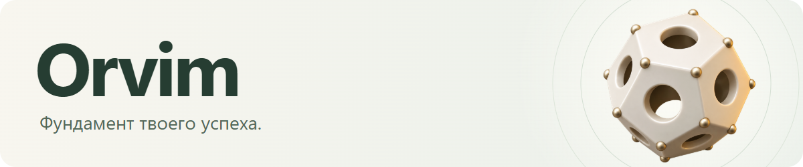
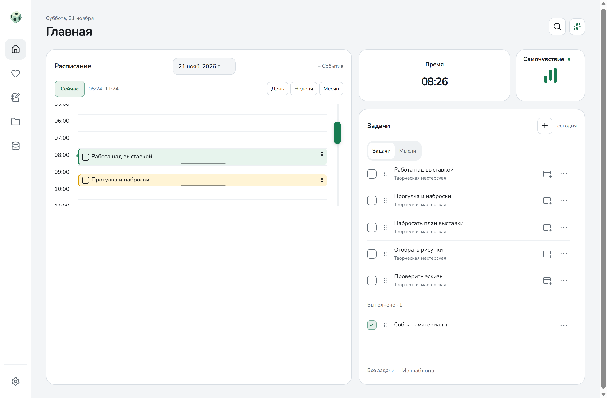

[English](README.md) | Русский

<p align="center">
  <picture>
    <source media="(max-width: 600px)" srcset="docs/assets/readme/hero-mobile-ru.png" />
    
  </picture>
</p>

<p align="center">
  Задачи, проекты, мысли и личные записи — в одном локальном пространстве.<br />
  Основные разделы работают без аккаунта и интернета.<br />
  <em>Фундамент твоего успеха.</em>
</p>

<p align="center">
  <a href="docs/INSTALLATION.md#windows"></a>
  <a href="docs/INSTALLATION.md#android"></a>
  <a href="docs/PRIVACY.md"></a>
  <a href="LICENSE"></a>
</p>

<p align="center">
  <strong>Orvim 0.4.49</strong><br />
  <a href="https://github.com/Adeptus-Amohus/orvim/releases/download/v0.4.49/Orvim-0.4.49-Windows-x64-setup.exe"><strong>Скачать Windows EXE</strong></a> &nbsp; · &nbsp;
  <a href="https://github.com/Adeptus-Amohus/orvim/releases/download/v0.4.49/Orvim-0.4.49-Android-arm64.apk"><strong>Скачать Android APK</strong></a><br />
  <a href="https://github.com/Adeptus-Amohus/orvim/releases/tag/v0.4.49">Релиз</a> &nbsp; / &nbsp;
  <a href="https://github.com/Adeptus-Amohus/orvim/releases/download/v0.4.49/SHA256SUMS.txt">SHA-256</a> &nbsp; / &nbsp;
  <a href="docs/INSTALLATION.md">Установка и первый запуск</a> &nbsp; / &nbsp;
  <a href="https://adeptus-amohus.github.io/orvim/?lang=ru">Сайт Orvim</a> &nbsp; / &nbsp;
  <a href="#интерфейс">Интерфейс</a> &nbsp; / &nbsp;
  <a href="#возможности">Возможности</a> &nbsp; / &nbsp;
  <a href="#разработка">Запуск</a> &nbsp; / &nbsp;
  <a href="docs/README.md">Документация</a>
</p>

## Интерфейс

Ваш день в одном окне. Расписание и задачи рядом.

<picture>
  <source media="(max-width: 740px)" srcset="site/assets/tour/home-mobile-full.webp" />
  
</picture>

<details>
<summary><strong>Мобильная версия</strong></summary>

- [Главная](site/assets/tour/home-mobile-full.webp) — Расписание и задачи рядом. Выберите день и отмечайте выполненные дела.
- [Жизнь](site/assets/tour/life-mobile-full.webp) — Отмечайте самочувствие, сон, питание и тренировки. Смотрите, как меняются ваши записи со временем.
- [Мысли](site/assets/tour/thoughts-mobile-full.webp) — Запишите мысль отдельно от списка дел. Возвращайтесь к заметкам, когда захотите развить идею.
- [Проекты](site/assets/tour/projects-mobile-full.webp) — Описание, материалы и задачи собраны в одном месте. На доске видно, что запланировано, в работе или готово.
- [База данных](site/assets/tour/database-mobile-full.webp) — Собирайте книги, фильмы и другие записи в коллекции. Добавляйте статусы, оценки и заметки.

</details>

<details>
<summary><strong>ПК-версия</strong></summary>

- [Главная](site/assets/tour/home-desktop-full.webp) — Расписание и задачи рядом. Выберите день и отмечайте выполненные дела.
- [Жизнь](site/assets/tour/life-desktop-full.webp) — Отмечайте самочувствие, сон, питание и тренировки. Смотрите, как меняются ваши записи со временем.
- [Мысли](site/assets/tour/thoughts-desktop-full.webp) — Запишите мысль отдельно от списка дел. Возвращайтесь к заметкам, когда захотите развить идею.
- [Проекты](site/assets/tour/projects-desktop-full.webp) — Описание, материалы и задачи собраны в одном месте. На доске видно, что запланировано, в работе или готово.
- [База данных](site/assets/tour/database-desktop-full.webp) — Собирайте книги, фильмы и другие записи в коллекции. Добавляйте статусы, оценки и заметки.

</details>

[Листать экраны на сайте Orvim](https://adeptus-amohus.github.io/orvim/?lang=ru#tour)

<sub>Снимки Orvim 0.4.49 на Windows и в Android-эмуляторе с демонстрационными записями.</sub>

## Возможности

| Раздел                     | Что внутри                                                                                                                      |
| -------------------------- | ------------------------------------------------------------------------------------------------------------------------------- |
| **Главная**                | Расписание и задачи на выбранный день, выполнение и отмена выполнения.                                                          |
| **Проекты и мысли**        | Задачи проекта, материалы, самостоятельные заметки, поиск и редактирование.                                                     |
| **Жизнь**                  | Личный день, самочувствие, сон, питание, вода, вес, тренировки, упражнения, цели, шаги, финансы и статистика.                   |
| **База данных**            | Пользовательские коллекции, обложки, оценки и архив завершённых дел.                                                            |
| **Данные и оформление**    | Зашифрованная локальная база, переносимые копии с паролем, автоматические снимки, русский и английский интерфейс, темы и звуки. |
| **На устройстве**          | Android-виджеты расписания/задач, мысли и питания; системный трей и настройка закрытия окна Windows.                            |
| **Подключения по желанию** | ИИ с вручную выбранными данными и подтверждением изменений, календарь, Health Connect, файловый/LAN-обмен с проверкой импорта.  |

Аккаунт Orvim не требуется. Подключённые сервисы могут требовать свои аккаунты, ключи, разрешения и оплату. Данные, отправленные сервису, обрабатываются по его условиям. [Данные и приватность](docs/PRIVACY.md).

Изменения и проверки текущего выпуска описаны в [заметках Orvim 0.4.49](docs/releases/0.4.49.md).

## Установка и сохранность данных

В версии **0.4.49** можно изменить время приёма пищи и порядок коллекций. Материалы проекта раскрываются по нажатию. [Заметки выпуска](docs/releases/0.4.49.md) · [Установка и обновление](docs/INSTALLATION.md).

Скачивание и инструкции доступны без аккаунта GitHub. Среда разработки для установки не нужна. Файлы находятся в [выпуске v0.4.49](https://github.com/Adeptus-Amohus/orvim/releases/tag/v0.4.49):

| Файл                                                                                                                        | Назначение                                                                                                    |
| --------------------------------------------------------------------------------------------------------------------------- | ------------------------------------------------------------------------------------------------------------- |
| [Скачать Windows EXE](https://github.com/Adeptus-Amohus/orvim/releases/download/v0.4.49/Orvim-0.4.49-Windows-x64-setup.exe) | Установщик Windows 10/11 x64; нужен WebView2. При отсутствии runtime установщик скачивает его через интернет. |
| [Скачать Android APK](https://github.com/Adeptus-Amohus/orvim/releases/download/v0.4.49/Orvim-0.4.49-Android-arm64.apk)     | Android 7.0/API 24+, ARM64, актуальный Android WebView. Отдельных x86 и 32-битных ARM APK нет.                |

Исходники APK и EXE зафиксированы в [коммите caba559](https://github.com/Adeptus-Amohus/orvim/tree/caba5599ec7638c3c41e6d1940735ac87c7f38f1). Сведения о сборке и SHA-256 входят в выпуск.

Установленные 0.4.46 и 0.4.47 с ошибкой 404 обновите вручную поверх прежней версии. Начиная с 0.4.48 Orvim использует подписанный список пакетов для встроенной установки. Windows EXE не подписан Authenticode и может вызывать системное предупреждение.

Перед обновлением создайте и проверьте **копию с паролем** вне приватной папки приложения. **Обновление с тестовых APK до 0.4.45 требует переустановки.** До удаления тестовой установки проверьте восстановление копии на отдельном устройстве. [Безопасный переход](docs/INSTALLATION.md#переход-со-старого-тестового-apk). Следующие release APK должны сохранять новый постоянный сертификат. Windows обновляется обычным установщиком поверх прежней версии. [Копии и восстановление](docs/BACKUPS.md).

Порядок перехода с тестового APK: переносимая копия с паролем → проверка восстановления → переустановка → восстановление данных. Автоматический снимок с ключом устройства и CSV не заменяют полную переносимую копию. [Сохранение существующего ключа подписи](docs/ANDROID_SIGNING.md).

## Разработка

Orvim использует **Tauri 2**, **React 19**, **JavaScript/TypeScript**, **Vite** и **Rust**. Нативное хранилище — SQLite/SQLCipher; Android-часть использует также Kotlin и Gradle. Зависимости закреплены `package-lock.json` и `src-tauri/Cargo.lock`.

Для Windows нужны Node.js **22.12+** (в CI используется 24), npm, Rust stable с MSVC, C++ Build Tools с Windows SDK и WebView2. Команды выполняются из корня репозитория:

```powershell
npm ci
npm run desktop:dev
```

Просмотр в браузере:

```powershell
npm run dev
```

Vite использует порт 1420. Браузерный режим хранит отдельные данные в IndexedDB и не подтверждает работу нативных функций EXE/APK.

### Android

Android требует **JDK 21**, SDK Platform 36, Build Tools 35.0.0 и 36.0.0, NDK и переменные `JAVA_HOME`, `ANDROID_HOME`, `NDK_HOME`:

```powershell
npm run android:check
npm run android:dev -- --host 127.0.0.1
```

Полная настройка, эмулятор, USB и APK: [ANDROID.md](docs/ANDROID.md). Инструкции используют окружение разработчика; .artifacts не требуется.

## Проверки и сборки

<details>
<summary><strong>Команды проверки и сборки Windows / Android</strong></summary>

```powershell
npm run format:check
npm run build
npm run test:ui
npm run rust:fmt
npm run rust:check
npm run rust:lint
npm run rust:test
npm run licenses:check
node scripts/verify-site.mjs
node scripts/verify-doc-links.mjs
```

```powershell
npm run desktop:build
npm run tauri -- build --bundles nsis
npm run android:build -- --apk --target aarch64 --ci
```

`desktop:build` создаёт EXE без установщика. Android release APK подписывается постоянным ключом. Подробности проверки файлов доступны в [отчёте выпуска](https://github.com/Adeptus-Amohus/orvim/releases/download/v0.4.49/Verification.md) и [GitHub CI](https://github.com/Adeptus-Amohus/orvim/actions). [Разработка](docs/DEVELOPMENT.md), [порядок выпуска](docs/RELEASING.md).

DOM-тесты используют синтетические сервисы. Физический ARM64-телефон, все OEM-лаунчеры, чистая Windows без WebView2 и живые аккаунты внешних подключений этим выпуском не проверены. Нативные проверки ранее выпущенных файлов и их границы описаны в [заметках 0.4.49](docs/releases/0.4.49.md).

</details>

## Структура

<details>
<summary><strong>Как устроен репозиторий</strong></summary>

```text
src/app/                     React/Tauri оболочка
src/features/workspace/      основной интерфейс, логика, адаптеры
src/assets/                  шрифты и исходники значков
src-tauri/src/               IPC, SQLite, копии, обмен, подключения
src-tauri/migrations/        миграции SQLite
src-tauri/gen/android/       Gradle, Kotlin, ресурсы и wrapper
tests/                       DOM, данные, браузерные сценарии
scripts/                     среда, лицензии, подготовка ресурсов
docs/                        инструкции, архитектура и история
site/                        сайт GitHub Pages
distribution/                происхождение и проверки готовых файлов
third-party/                 сторонние лицензии и уведомления
```

Сохранены прежние модули MVP. Текущий интерфейс запускается через src/app/FullApp.tsx; текущая модель описана в [архитектуре](docs/ARCHITECTURE.md). Идентификатор local.lifeos.client и старые технические имена остаются для совместимости установок и копий.

Статистика языков зависит от фактического состава файлов: прежний публичный репозиторий содержал только HTML/CSS/JS сайта; теперь учитываются также JavaScript/TypeScript приложения, Rust, Kotlin, тесты и инструменты. Атрибуты Linguist ради процентов не меняются. [Состав файлов](docs/REPOSITORY.md#языки-и-состав-файлов).

</details>

## Документация и участие

| Для пользователя                              | Для разработчика                        |
| --------------------------------------------- | --------------------------------------- |
| [Данные и приватность](docs/PRIVACY.md)       | [Архитектура](docs/ARCHITECTURE.md)     |
| [Копии и восстановление](docs/BACKUPS.md)     | [Настройка Android](docs/ANDROID.md)    |
| [Синхронизация](docs/SYNC_0_4.md)             | [Участие в проекте](CONTRIBUTING.ru.md) |
| [Health Connect](docs/HEALTH_CONNECT.md)      | [Безопасность](SECURITY.ru.md)          |
| [Обновления](docs/INSTALLATION.md#обновление) | [История изменений](CHANGELOG.md)       |

[Открыть всю документацию →](docs/README.md)

### Обратная связь

[Напишите автору](mailto:a.baimurzinov1@gmail.com), если хотите задать вопрос или поделиться отзывом. Для [сообщения об ошибке на GitHub](https://github.com/Adeptus-Amohus/orvim/issues/new?template=bug.yml) понадобится аккаунт. Укажите версию Orvim, версию Windows или Android и шаги, на которых возникает ошибка. Личные записи, копии базы и ключи оставляйте за пределами публичного отчёта. [Как отправить отзыв](CONTRIBUTING.ru.md#отзывы-и-сообщения-об-ошибках).

## Лицензия

Собственный код, документация и оригинальные ресурсы проекта распространяются под **Apache-2.0**, кроме компонентов с отдельно указанными условиями. См. [LICENSE](LICENSE), [NOTICE](NOTICE) и [разбор лицензий](docs/LICENSES.md). Шрифты сохраняют SIL OFL 1.1; зависимости и пользовательские материалы не перелицензируются.

Полные сторонние тексты: [THIRD_PARTY_LICENSES.txt](THIRD_PARTY_LICENSES.txt). Подготовка и проверка: `npm run licenses:generate` и `npm run licenses:check`; область покрытия описана в [third-party/README.md](third-party/README.md).
